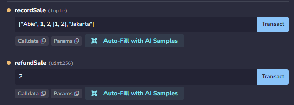

# Dokumentasi Perbaikan UTS — ComLedger: Sistem Buku Besar Penjualan Toko Komputer Berbasis Blockchain

**Kelompok 1** — Marsel; Nazwa Nabila; Abie Prayoga Alfarisi

## 1. Kondisi Awal Kode (Sebelum Revisi)

Pada versi awal, kontrak sudah memiliki fondasi sistem buku besar, tetapi **belum memiliki alur transaksi**:

| Komponen | Kondisi Awal |
|---|---|
| Data master | Produk, aksesori, dan staff sudah dapat dikelola (`struct` + `mapping`) |
| Hak akses | Modifier `onlyOwner` dan `onlyStaff` sudah ada |
| Buku besar | Rantai blok berhash (`LedgerBlock`) dengan Genesis Block dan `verifyChain()` |
| Enum status transaksi | **Belum ada** |
| Fungsi penjualan | **Belum ada** sebagai fungsi tersendiri |
| Fungsi refund | **Belum ada** |

Artinya, pada kondisi awal `getChainLength()` hanya bernilai **1** (Genesis Block) dan belum ada satu pun catatan penjualan yang bisa diaudit. Revisi difokuskan menambah alur transaksi tersebut.

## 2. Perbaikan yang Telah Dilakukan

### 2.1. Revisi 1.1 — Tambah Enum `StatusTransaksi`

**Status: Selesai**

```solidity
enum StatusTransaksi { Berhasil, Direfund }
```

Enum ini benar-benar dipakai pada logika kontrak: sebagai field `status` di `struct Sale`, sebagai nilai pada mapping `statusTransaksi`, dan sebagai kondisi `require` di `recordSale` serta `refundSale`.

**Alasan memakai enum (bukan string atau bool):**
- Nilainya terbatas dan pasti valid, sehingga tidak ada risiko salah ketik seperti pada `string`.
- Lebih hemat gas dibanding `string`.
- Lebih mudah diperluas (misalnya menambah `Pending`) dibanding `bool` yang hanya punya dua keadaan.
- Kode lebih mudah dibaca: `StatusTransaksi.Direfund` lebih jelas daripada `true/false`.

### 2.2. Revisi 1.2 — Fungsi Penjualan `recordSale`

**Status: Selesai**

Fungsi `recordSale(SaleInput input)` mencatat transaksi penjualan secara lengkap:

- Hanya dapat dipanggil staff aktif (modifier `onlyStaff`).
- `require`: pembeli dan lokasi terisi, produk ada, produk aktif, jumlah lebih dari nol, stok mencukupi.
- Stok produk dikurangi sebesar jumlah yang terjual.
- Transaksi disimpan lengkap di `struct Sale`: id produk, jumlah, harga satuan saat transaksi (`unitPrice`), total harga, pencatat (`msg.sender`), waktu (`block.timestamp` pada `LedgerBlock`), dan status awal `Berhasil`.
- Event `SaleRecorded(transactionId, productId, quantity, total)` di-emit.

**Snapshot harga:** harga yang dicatat adalah harga saat transaksi terjadi. Jika harga produk berubah kemudian, catatan lama tidak ikut berubah, karena total disimpan pada transaksi dan tidak dihitung ulang dari harga produk terkini.

> Catatan: total dihitung `(unitPrice + accessoryPrice) × quantity` karena sistem mendukung aksesori. Tanpa aksesori, hasilnya sama dengan jumlah × harga satuan.

[](rev.png)

### 2.3. Revisi 1.3 — Fungsi Refund `refundSale`

**Status: Selesai**

Fungsi `refundSale(uint256 blockIndex)`:

- Hanya dapat dipanggil owner (modifier `onlyOwner`).
- `require` transaksi ditemukan dan statusnya masih `Berhasil`.
- Status diubah menjadi `Direfund` (di mapping `statusTransaksi`).
- Stok produk dikembalikan sesuai jumlah pada transaksi.
- Blok refund dicatat ke ledger dan event `SaleRefunded(originalBlock, refundBlock, by)` di-emit.

**Perlindungan anti refund-ganda** ditegakkan di dalam kontrak:

```solidity
require(statusTransaksi[blockIndex] == StatusTransaksi.Berhasil, "Transaksi sudah direfund");
```

Status diubah sebelum langkah lain (pola *checks-effects-interactions*), sehingga panggilan kedua pada transaksi yang sama pasti `revert`.

**Mengapa status disimpan di mapping?** Blok yang sudah di-hash tidak boleh diubah, karena akan merusak `verifyChain()`. Maka blok penjualan asli tetap utuh, sedangkan status terkini disimpan di `statusTransaksi`.

[](rev.png)

### 2.4. Revisi 1.4 — Nama Resmi ComLedger

**Status: Selesai**

Nama kontrak diganti menjadi `contract ComLedger` dan nama file menjadi `ComLedger.sol`. Nama lama sudah tidak muncul pada kode, laporan, README, maupun repository.

### 2.5. Penguat 1.P1 — Event pada Restock dan Perubahan Harga

**Status: Selesai**

| Fungsi | Event | Isi |
|---|---|---|
| `restock(id, amount)` | `Restocked` | id produk, jumlah tambahan, stok baru |
| `setProductPrice(id, price)` | `PriceChanged` | id produk, harga lama, harga baru, pelaku |
| `setProductActive(id, active)` | `ProductActiveChanged` | id produk, status aktif, pelaku |

Dengan event ini, setiap perubahan stok dan harga tercatat di logs dan dapat diaudit.

## 3. Pengujian di Remix IDE

### 3.0. Persiapan

1. Buka [remix.ethereum.org](https://remix.ethereum.org), buat file `ComLedger.sol`, lalu tempel kode kontrak.
2. Tab **Solidity Compiler** → pilih versi `0.8.20` atau lebih baru → **Compile ComLedger.sol**.
3. Tab **Deploy & Run Transactions** → *Environment*: **Remix VM** → *Contract*: **ComLedger** → **Deploy** memakai **ACCOUNT 1**. Account 1 otomatis menjadi **Owner**.
4. Siapkan tiga akun dari dropdown *Account*:
   - **Account 1** = Owner
   - **Account 2** = Kasir (staff), disalin alamatnya
   - **Account 3** = Bukan staff (untuk uji negatif)
5. Jalankan `seedSampleCatalog()` (Account 1). Produk 1 = *AMD AM4 - B550*, harga `1750000`, stok `10`.
6. Daftarkan kasir: `setStaff` dengan isi `account` = alamat Account 2, `name` = `Kasir Farrel`, `role` = `1` (Cashier), `active` = `true`.

> Jika muncul pop-up *Gas estimation failed* saat uji negatif, itu **normal**. Pesan revert terbaca di pop-up atau di Console (tanda merah). Klik **Send Transaction** bila ingin tetap melihat hasilnya di Console.

---

### 3.1. Fungsi Transaksi Penjualan

**Tujuan:** membuktikan bahwa sebelum revisi belum ada transaksi, dan setelah revisi penjualan tercatat lengkap.

**A. kondisi awal (belum ada transaksi)**

| Langkah | Aksi di Remix | Hasil yang diharapkan |
|---|---|---|
| 1 | `getChainLength()` | `1` (hanya Genesis Block) |
| 2 | `getStock(1)` | `10` |
| 3 | `products(1)` | harga `1750000`, stok `10` |

**B. Skenario negatif penjualan**

| Langkah | Akun | Aksi | Hasil yang diharapkan |
|---|---|---|---|
| 4 | Account 3 | `recordSale(["Abie",1,2,[],"Jakarta"])` | **revert** `Bukan staff aktif` |
| 5 | Account 2 | `recordSale(["Abie",1,0,[],"Jakarta"])` | **revert** `Jumlah harus lebih dari nol` |
| 6 | Account 2 | `recordSale(["Abie",1,99,[],"Jakarta"])` | **revert** `Stok tidak mencukupi` |

> Format parameter `SaleInput` di Remix: `["pembeli", idProduk, jumlah, [idAksesori], "lokasi"]`.

**C. Happy path penjualan**

| Langkah | Akun | Aksi | Hasil yang diharapkan |
|---|---|---|---|
| 7 | Account 2 | `recordSale(["Abie",1,2,[],"Jakarta"])` | Transaksi sukses |
| 8 | – | Buka **logs** di Console | Event `BlockAdded` dan `SaleRecorded(2, 1, 2, 3500000)` |

**D. Verifikasi hasil**

| Langkah | Aksi | Hasil yang diharapkan |
|---|---|---|
| 9 | `getStock(1)` | `8` (berkurang 2) |
| 10 | `getChainLength()` | `2` |
| 11 | `getBlock(2)` | `unitPrice` = 1750000, `quantity` = 2, `total` = **3500000**, `recordedBy` = alamat Account 2, `timestamp` terisi, `status` = `0` (Berhasil) |
| 12 | `getStatusTransaksi(2)` | `0` (Berhasil) |
| 13 | `isChainValid()` | `true` |

**E. Bukti snapshot harga**

| Langkah | Akun | Aksi | Hasil yang diharapkan |
|---|---|---|---|
| 14 | Account 1 | `setProductPrice(1, 1900000)` | Event `PriceChanged(1, 1750000, 1900000, owner)` di logs |
| 15 | – | `getBlock(2)` | `unitPrice` **tetap 1750000** dan `total` tetap 3500000 |

**F. (Opsional) Bukti event Restock untuk Penguat 1.P1**

| Langkah | Akun | Aksi | Hasil yang diharapkan |
|---|---|---|---|
| 16 | Account 2 | `restock(1, 5)` | Event `Restocked(1, 5, 13)` di logs |

**Poin narasi video 1:**
1. "Sebelum revisi, rantai hanya berisi Genesis Block, belum ada catatan penjualan."
2. "Setelah revisi, `recordSale` memvalidasi akses, produk, jumlah, dan stok."
3. "Transaksi tersimpan lengkap dan stok berkurang."
4. "Harga disimpan sebagai snapshot, sehingga perubahan harga tidak mengubah transaksi lama."

[](https://github.com/user-attachments/assets/439ef8aa-a66d-4acb-a711-20c757f7e10b)

**Link video 1:** `GANTI_DENGAN_LINK_VIDEO_1`

---

### 3.2. Fungsi Refund

**Tujuan:** membuktikan refund mengubah status, mengembalikan stok, dan tidak bisa dilakukan dua kali.

**Prasyarat:** transaksi blok `2` dari Video 1 sudah ada. Jika memulai dari awal, jalankan dulu `recordSale(["Abie",1,2,[],"Jakarta"])` dengan Account 2.

**A. Kondisi sebelum refund**

| Langkah | Aksi | Hasil yang diharapkan |
|---|---|---|
| 1 | `getStatusTransaksi(2)` | `0` (Berhasil) |
| 2 | `getStock(1)` | `8` |
| 3 | `getChainLength()` | `2` |

**B. Skenario negatif refund (sebelum refund pertama)**

| Langkah | Akun | Aksi | Hasil yang diharapkan |
|---|---|---|---|
| 4 | Account 2 (staff, bukan owner) | `refundSale(2)` | **revert** `Hanya owner` |
| 5 | Account 3 (bukan staff) | `refundSale(2)` | **revert** `Hanya owner` |
| 6 | Account 1 (owner) | `refundSale(99)` | **revert** `Transaksi tidak ditemukan` |
| 7 | Account 1 (owner) | `refundSale(1)` (Genesis) | **revert** `Transaksi tidak ditemukan` |

**C. Happy path refund**

| Langkah | Akun | Aksi | Hasil yang diharapkan |
|---|---|---|---|
| 8 | Account 1 (owner) | `refundSale(2)` | Transaksi sukses |
| 9 | – | Buka **logs** | Event `BlockAdded` (blok 3) dan `SaleRefunded(2, 3, alamatOwner)` |

**D. Verifikasi hasil**

| Langkah | Aksi | Hasil yang diharapkan |
|---|---|---|
| 10 | `getStatusTransaksi(2)` | `1` (**Direfund**) |
| 11 | `getStock(1)` | `10` (kembali bertambah 2) |
| 12 | `getChainLength()` | `3` |
| 13 | `getBlock(3)` | `status` = `1` (Direfund), `refBlock` = `2`, `quantity` = 2 |
| 14 | `getBlock(2)` | Isi blok asli **tidak berubah** (`status` tetap `0`), sehingga hash utuh |
| 15 | `isRefunded(2)` | `true` |
| 16 | `isChainValid()` | `true` |

**E. Bukti anti refund-ganda**

| Langkah | Akun | Aksi | Hasil yang diharapkan |
|---|---|---|---|
| 17 | Account 1 (owner) | `refundSale(2)` lagi | **revert** `Transaksi sudah direfund` |
| 18 | Account 1 (owner) | `refundSale(3)` (blok refund) | **revert** `Bukan transaksi penjualan` |
| 19 | – | `getStock(1)` | Tetap `10` (stok tidak bertambah dua kali) |

1. "Refund hanya bisa dilakukan owner, dan transaksi harus ada serta berstatus Berhasil."
2. "Status berubah menjadi Direfund, stok dikembalikan, dan event `SaleRefunded` tercatat."
3. "Blok penjualan asli tidak diubah, agar rantai hash tetap valid. Status terkini ada di mapping."
4. "Refund kedua di-revert oleh `require` di dalam kontrak, bukan oleh pengecekan di luar kontrak."

[](https://github.com/user-attachments/assets/aec9785f-a26e-4303-b998-f0664a704243)

**Link video 2:** `GANTI_DENGAN_LINK_VIDEO_2`

## 4. Analisis Keamanan — Temuan yang Telah Ditindaklanjuti

> Analisis keamanan pada laporan awal tetap dipertahankan. Sub-bab ini menunjukkan temuan yang kini sudah ditindaklanjuti melalui revisi.

| Temuan | Risiko | Tindak Lanjut | Bukti |
|---|---|---|---|
| Penjualan tanpa validasi stok | Stok negatif / overselling | `require(quantity <= stock)` di `recordSale` | Video 1, langkah 6 |
| Pencatat tidak dibatasi | Siapa pun dapat menulis transaksi | Modifier `onlyStaff` | Video 1, langkah 4 |
| Harga berubah memengaruhi catatan lama | Riwayat tidak dapat diaudit | Snapshot `unitPrice` dan `total` di transaksi | Video 1, langkah 14–15 |
| Refund ganda | Stok digelembungkan | `require` status `Berhasil` + status diubah sebelum langkah lain | Video 2, langkah 17 |
| Refund oleh pihak tidak berwenang | Manipulasi stok | Modifier `onlyOwner` | Video 2, langkah 4–5 |
| Perubahan stok dan harga tidak terlacak | Tidak ada jejak audit | Event `Restocked` dan `PriceChanged` | Logs Remix |
| Blok lama diubah saat refund | Rantai hash rusak | Status refund disimpan di mapping, blok asli tidak diubah | Video 2, langkah 14 dan 16 |
| Nilai default enum (`Berhasil` = 0) | Blok Genesis tampak berstatus Berhasil | `refundSale` menolak `blockIndex <= 1` | Video 2, langkah 7 |
